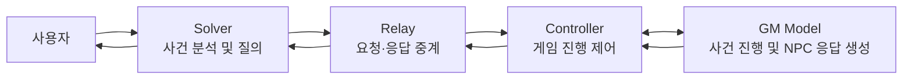

# AI 탐정 모의훈련

## 프로그램 목적
본 프로그램은 [CyberGround의 AI 과학 수사](https://cyberground.team/) 문제 해결을 연습하기 위해 제작된 모의 수사 프로그램입니다. 디지털 포렌식 문제를 AI를 활용해 해결하는 상황을 가정하고, 사용자가 Codex를 이용해 사건 파일과 초기 증거를 기반으로 AI NPC를 수사하여 새로운 단서를 확보해나가는 것을 연습하기 위해 개발되었습니다.

**더 다양한 사건과 실제 문제 해결은 [CyberGround](https://cyberground.team/)에서 경험하시는 것을 추천드립니다.**

<br>


## 프로그램 구성

본 프로그램은 `solver`, `relay`, `gm`의 세 구성 요소가 협력하여 동작합니다.



### Solver

- 사용자가 사건 파일과 증거를 분석하고 AI NPC에게 질문할 수 있도록
- 지원합니다. 질문을 `relay`로 전달하고 반환된 응답을 사용자에게 보여줍니다.

### Relay

- `solver`와 `Controller` 사이에서 요청과 응답을 중계하는 통신 계층입니다. 
- 각 구성 요소 사이의 데이터 전달과 통신 흐름을 관리합니다.
- 각 구성 요소가 전달한 데이터를 저장하여 각 단계별로 확인이 가능합니다.

### GM

- `Controller`의 요청을 바탕으로 현재 사건 상태와 Solver의 질문을 확인하고, 사건 맥락에 맞는 AI NPC의 응답과 진행 결과를 생성합니다. 
- `GM`은 질문이 현재 공개된 증거와 사건 맥락에 근거하는지 해금 규칙에 따라 판단하며, 조건을 충족하면 새로운 증거를 해금합니다. 
- `Controller`는 `GM`의 결과를 다시 `relay`와 `solver`를 거쳐 사용자에게 전달합니다.

<br>

작동 흐름은 다음과 같습니다.

1. 사용자가 `solver`를 통해 AI NPC에게 질문합니다.
2. `solver`가 질문을 `relay`로 전달합니다.
3. `relay`가 질문과 사건 정보를 `Controller`에 전달합니다.
4. `Controller`가 Solver의 질문과 현재 사건 상태를 `GM Model`에 전달합니다.
5. `GM Model`이 질문을 사건의 단서와 비교해 답변할 수 있는 내용인지 확인하고, 새로운 증거를 보여줄 조건이 충족되었는지 판단합니다.
6. `GM Model`이 AI NPC의 응답과 해금된 새 증거를 반환합니다.
7. `Controller`가 결과를 반영한 공개 응답을 `relay`로 보내고, `relay`가 이를 `solver`에 전달합니다.
8. `solver`가 NPC 응답과 새로 해금된 증거를 사용자에게 보여줍니다.
ai-detective-solver 폴더에서만 코덱스를 작동시켜 사건의 모든 단서를 풀어보세요.

<br>

## 게임 실행

PowerShell에서 다음 명령을 실행합니다.

```powershell
cd 사용자의 경로\ai-detective-solver
codex --no-daemon
```

<br>

### 활용 코덱스 모델 추천
```text
- 문제 제공 및 단서 해금 판단 모델: gpt-5.6-terra medium 추론 수준 (이 모델은 고정)
- 사용자 모델: gpt-5.6-Luna medium 추론 수준
```
<br>

프로젝트 신뢰 여부를 묻는다면 신뢰하도록 선택합니다. Codex가 열리면 다음과 같이 요청합니다.

```text
게임 시작해줘.
```

<br>

사건이 여러 개라면 플레이할 사건을 선택합니다. 게임이 시작되면 자연어로 수사를 요청할 수 있습니다.

```text
현재까지 확인된 사실을 정리해 줘.
다음 조사를 진행해 줘.
이 증거를 바탕으로 마진우에게 질문해 줘.
```

현재 가진 증거 및 사건 상황을 천천히 읽고 싶다면 `ai-detective-solver` 폴더 안의 *investigation.md* 파일을 확인하세요

<br>

게임을 끝내려면 다음과 같이 요청하거나 Codex를 종료합니다.

```text
게임 종료해 줘.
```
<br>

## 게임 목표

공개된 증거와 NPC 답변을 연결해 모든 증거를 해금하는 것이 목표입니다.

마지막 증거를 해금하면 다음 완료 메시지가 표시됩니다.

```text
축하합니다. 모든 증거를 다 풀었습니다.
게임이 자동 종료됩니다.
```

완료 메시지와 마지막 증거가 전달된 뒤 게임은 자동으로 종료됩니다. Codex 대화는 그대로 유지되므로 결과를 정리하거나 새 게임을 요청할 수 있습니다.
<br>

## 새 게임 시작

진행 기록이 있는 상태에서 새 게임을 시작하면 초기화 여부를 묻습니다. 초기화를 선택하면 기존 진행 상태와 공개 증거, NPC 응답, 수사 기록을 초기화하고 새 게임을 시작합니다.

<br>

## 새로운 사건 만들기

`ai-detective-gm/cases/case_001`을 복제해 새 사건 디렉터리를 만들고 다음 파일을 작성합니다.

- `private/ground_truth.json`: 사건의 진실, 타임라인, 인물 행동 및 전체 증거 목록
- `private/npc_knowledge.json`: NPC별 지식, 관찰, 전언 및 기억 한계
- `private/unlock_rules.json`: 증거 해금 규칙
- `private/evidence/*.md`: 증거 본문
- `state/game_state.json`: 게임 진행 상태

새 사건 디렉터리는 게임의 사건 선택 목록에 자동으로 나타납니다.

<br>

## 테스트

프로젝트 루트에서 다음 명령을 실행합니다.

```powershell
cd D:\projects\codex_test
python -m unittest discover -s tests -v
```
